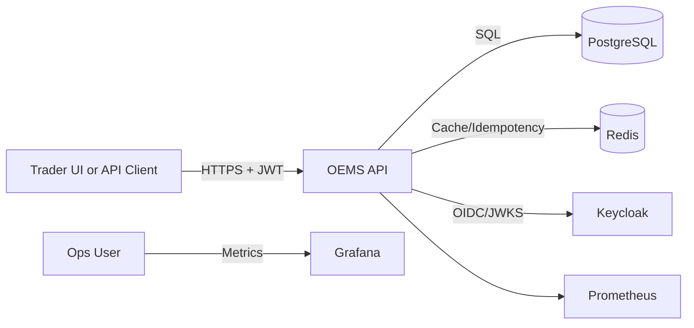
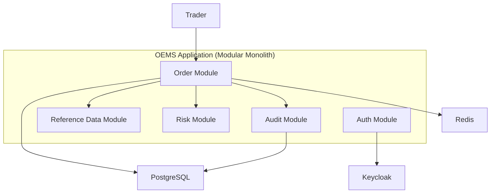
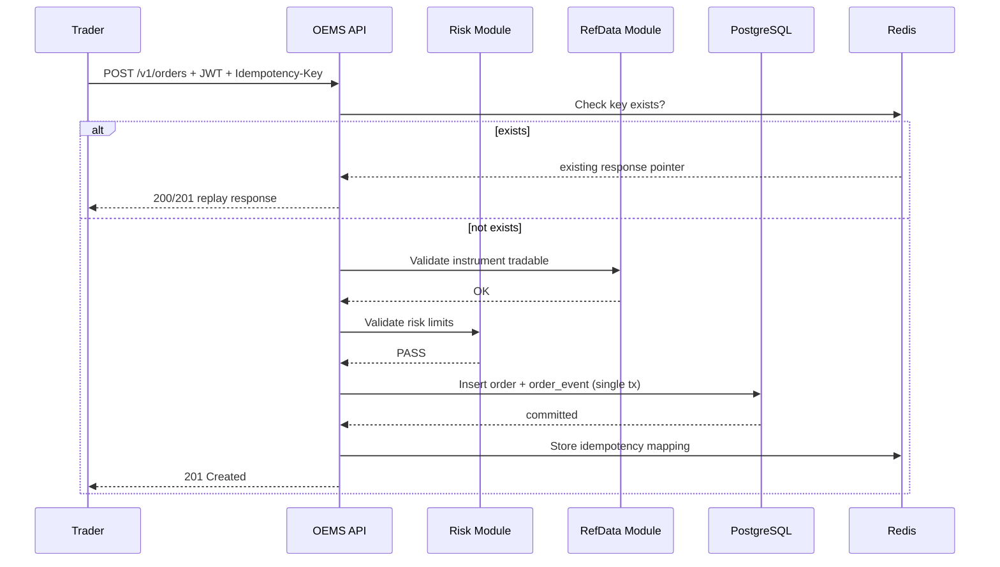
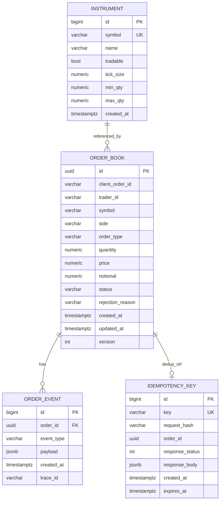

# OEMS Phase 1 Cookbook (From Scratch)

Last updated: 2026-03-03

## 1. What this guide is

This is a practical, end-to-end cookbook to build a **Phase 1 OEMS** product where:

- A trader can authenticate.
- A trader can place an order for an instrument.
- The system validates instrument + basic risk checks.
- The system stores immutable audit events.
- The trader can query the order by id.

This guide is written so you can execute it step by step and also learn required concepts before each step.

## 2. Phase 1 boundaries

### In scope

- `POST /v1/orders`
- `GET /v1/orders/{orderId}`
- Instrument master data (at least read APIs)
- JWT auth with role `TRADER`
- Basic risk checks:
  - max quantity
  - max notional
  - price band
- Idempotency key on order placement
- Audit event trail
- Basic observability (logs, metrics, health)

### Out of scope (Phase 2+)

- Full exchange integration
- Advanced order types (stop, iceberg, algo)
- Amend/cancel workflow
- Portfolio projections
- Complex risk engines
- Multi-region HA

## 3. Recommended up-to-date stack (as of 2026-03-03)

- Java: `25` (LTS)
- Spring Boot: `4.0.3`
- Build: Maven `3.9+`
- DB: PostgreSQL `18.x`
- Cache/idempotency fast path: Redis `8.6.x`
- Auth server: Keycloak `26.5.x`
- Optional event bus: Kafka `4.1.x` (not required for Phase 1)
- Container runtime: Docker Desktop + Docker Compose
- Testing: JUnit 5, Testcontainers
- API docs: OpenAPI 3.1

Note: Verify versions before you start implementation.

## 4. High-level implementation strategy

For Phase 1, build as a **modular monolith** for speed:

- Faster delivery
- Easier debugging
- Lower operational complexity
- Still cleanly separable into microservices later

Suggested internal modules:

- `auth`
- `reference-data`
- `order`
- `risk`
- `audit`

---

## Step 0 - Learning warm-up (do this before coding)

### Objective

Build minimum conceptual foundation so implementation decisions make sense.

### Concepts prerequisites

Learn these topics first:

1. Trading basics
   - Instrument, side, quantity, price, notional
   - Market vs limit order
2. HTTP API design
   - idempotency
   - status codes
   - request validation
3. Database basics
   - ACID transactions
   - foreign keys
   - indexes
4. Security basics
   - OAuth2/OIDC
   - JWT claims
   - RBAC
5. Spring basics
   - layered architecture
   - dependency injection
   - Bean validation

### Deliverables

- One-page personal notes for each topic.
- A glossary in `docs/GLOSSARY.md` (optional but recommended).

### Done checklist

- You can explain why idempotency is mandatory for order placement.
- You can explain difference between authentication and authorization.
- You can explain why audit events must be immutable.

---

## Step 1 - Product definition and acceptance criteria

### Objective

Define exactly what "Phase 1 done" means.

### Concepts prerequisites

- Functional vs non-functional requirements
- User story + acceptance criteria format
- SLA/SLO basics

### Actions

1. Create `docs/PHASE1_PRD.md`.
2. Write user stories:
   - As a trader, I can place an order for a tradable instrument.
   - As a trader, I can retrieve order status by id.
   - As ops, I can inspect an audit trail for any order.
3. Define NFR targets:
   - p95 `POST /orders` < 150 ms (local env target for Phase 1)
   - availability target for single environment
   - all API requests logged with trace id
4. Define explicit rejection rules:
   - unknown instrument
   - quantity beyond limit
   - notional beyond limit
   - price outside configured band

### Deliverables

- `docs/PHASE1_PRD.md`
- Done criteria section approved by stakeholders

### Done checklist

- No ambiguous requirement remains.
- Every API endpoint has success and error acceptance criteria.

---

## Step 2 - Architecture decisions and ADRs

### Objective

Record major technical choices early to avoid rework.

### Concepts prerequisites

- Monolith vs microservices tradeoffs
- Bounded context
- ADR (Architecture Decision Record)

### Actions

1. Create `docs/adr/`.
2. Add ADR files:
   - `ADR-001-modular-monolith-phase1.md`
   - `ADR-002-postgresql-primary-store.md`
   - `ADR-003-keycloak-for-auth.md`
   - `ADR-004-idempotency-with-db-and-redis.md`
3. For each ADR, include:
   - context
   - decision
   - alternatives
   - consequences

### Deliverables

- ADR folder with at least 4 decisions.

### Done checklist

- Team can answer "why this tech?" using ADR docs.

---

## Step 3 - Create architecture diagrams (mandatory before implementation)

### Objective

Create diagrams that anchor design conversations and code reviews.

### Concepts prerequisites

- C4 model (Context, Container, Component)
- Sequence diagram
- ER diagram
- Deployment diagram

### Actions

Create `docs/architecture/01-system-context.md` with Mermaid:



Create `docs/architecture/02-container-view.md`:



Create `docs/architecture/03-sequence-place-order.md`:



Create `docs/architecture/04-erd.md`:



### Deliverables

- 4+ architecture files in `docs/architecture/`

### Done checklist

- A new engineer can understand flow without reading code.
- Sequence diagram covers success + duplicate request path.

---

## Step 4 - Local developer environment setup

### Objective

Get reproducible local setup for all developers.

### Concepts prerequisites

- Docker volumes and networks
- Java toolchain setup
- Environment variables and `.env` files

### Actions

1. Install tools:
   - JDK 25
   - Maven 3.9+
   - Docker Desktop
2. Create `docs/SETUP.md` with all commands.
3. Add `docker-compose.yml` for:
   - postgres
   - redis
   - keycloak
   - prometheus
   - grafana

Minimal compose skeleton:

```yaml
services:
  postgres:
    image: postgres:18
    environment:
      POSTGRES_USER: oems
      POSTGRES_PASSWORD: oems
      POSTGRES_DB: oems
    ports: ["5432:5432"]
    volumes:
      - pgdata:/var/lib/postgresql/data

  redis:
    image: redis:8.6
    ports: ["6379:6379"]

  keycloak:
    image: quay.io/keycloak/keycloak:26.5.4
    command: ["start-dev"]
    environment:
      KEYCLOAK_ADMIN: admin
      KEYCLOAK_ADMIN_PASSWORD: admin
    ports: ["8089:8080"]

volumes:
  pgdata:
```

4. Add startup command docs:

```powershell
docker compose up -d
docker compose ps
```

### Deliverables

- `docker-compose.yml`
- `docs/SETUP.md`

### Done checklist

- `docker compose ps` shows all services healthy/running.
- Developers can start env in under 10 minutes.

---

## Step 5 - Repository bootstrap and structure

### Objective

Create clear project structure with predictable package layout.

### Concepts prerequisites

- Maven multi-module
- Hexagonal/layered architecture
- Dependency boundaries

### Actions

If starting from empty repo:

1. Create root parent `pom.xml`.
2. Create modules:
   - `shared/common`
   - `shared/contracts`
   - `apps/oems-api` (single deployable app for Phase 1)
3. In `apps/oems-api`, organize packages:
   - `api`
   - `application`
   - `domain`
   - `infrastructure`
   - `config`
4. Add checkstyle/spotless/formatter early.

### Deliverables

- Compiling multi-module structure
- Baseline `mvn clean verify` success

### Done checklist

- Build is green on a clean machine.
- No cyclic dependencies across modules.

---

## Step 6 - Database design in detail

### Objective

Design relational schema supporting order placement + audit + idempotency.

### Concepts prerequisites

- Primary keys vs business keys
- Unique constraints
- Transaction isolation
- Index design for read patterns

### Actions

Create migration `V1__baseline.sql` with core tables.

```sql
CREATE TABLE instrument (
    id BIGSERIAL PRIMARY KEY,
    symbol VARCHAR(32) NOT NULL UNIQUE,
    name VARCHAR(128) NOT NULL,
    tradable BOOLEAN NOT NULL DEFAULT TRUE,
    tick_size NUMERIC(18,8) NOT NULL,
    min_qty NUMERIC(18,8) NOT NULL,
    max_qty NUMERIC(18,8) NOT NULL,
    created_at TIMESTAMPTZ NOT NULL DEFAULT now()
);

CREATE TABLE order_book (
    id UUID PRIMARY KEY,
    client_order_id VARCHAR(64),
    trader_id VARCHAR(64) NOT NULL,
    symbol VARCHAR(32) NOT NULL,
    side VARCHAR(8) NOT NULL CHECK (side IN ('BUY', 'SELL')),
    order_type VARCHAR(16) NOT NULL CHECK (order_type IN ('MARKET', 'LIMIT')),
    quantity NUMERIC(18,8) NOT NULL CHECK (quantity > 0),
    price NUMERIC(18,8),
    notional NUMERIC(20,8) NOT NULL,
    status VARCHAR(16) NOT NULL,
    rejection_reason VARCHAR(128),
    created_at TIMESTAMPTZ NOT NULL DEFAULT now(),
    updated_at TIMESTAMPTZ NOT NULL DEFAULT now(),
    version INT NOT NULL DEFAULT 0
);

CREATE INDEX idx_order_book_trader_created
    ON order_book (trader_id, created_at DESC);

CREATE TABLE order_event (
    id BIGSERIAL PRIMARY KEY,
    order_id UUID NOT NULL REFERENCES order_book(id),
    event_type VARCHAR(32) NOT NULL,
    payload JSONB NOT NULL,
    trace_id VARCHAR(64),
    created_at TIMESTAMPTZ NOT NULL DEFAULT now()
);

CREATE INDEX idx_order_event_order_id_created
    ON order_event(order_id, created_at ASC);

CREATE TABLE idempotency_key (
    id BIGSERIAL PRIMARY KEY,
    idem_key VARCHAR(128) NOT NULL UNIQUE,
    request_hash VARCHAR(128) NOT NULL,
    order_id UUID,
    response_status INT NOT NULL,
    response_body JSONB NOT NULL,
    created_at TIMESTAMPTZ NOT NULL DEFAULT now(),
    expires_at TIMESTAMPTZ NOT NULL
);
```

Create migration `V2__risk_limits.sql`:

```sql
CREATE TABLE risk_limit (
    id BIGSERIAL PRIMARY KEY,
    trader_id VARCHAR(64) NOT NULL,
    symbol VARCHAR(32),
    max_qty NUMERIC(18,8) NOT NULL,
    max_notional NUMERIC(20,8) NOT NULL,
    price_band_pct NUMERIC(8,4) NOT NULL,
    created_at TIMESTAMPTZ NOT NULL DEFAULT now()
);

CREATE INDEX idx_risk_limit_trader_symbol
    ON risk_limit (trader_id, symbol);
```

### Deliverables

- SQL migrations for baseline + risk

### Done checklist

- Tables, constraints, indexes map exactly to API use-cases.
- No nullable critical field without reason.

---

## Step 7 - Migration and persistence setup

### Objective

Ensure deterministic schema evolution through Flyway.

### Concepts prerequisites

- Schema migration lifecycle
- Backward-compatible DB changes
- Roll-forward strategy

### Actions

1. Configure Flyway:
   - `spring.flyway.enabled=true`
   - `spring.flyway.locations=classpath:db/migration`
2. Disable auto-DDL:
   - `spring.jpa.hibernate.ddl-auto=validate`
3. Add startup guard:
   - app fails fast if migration fails
4. Add script for local reset:

```powershell
docker compose down -v
docker compose up -d postgres
```

### Deliverables

- Flyway-controlled schema with reproducible startup

### Done checklist

- Fresh environment starts without manual SQL.
- Migration history table is present and consistent.

---

## Step 8 - Security and identity integration

### Objective

Secure APIs using JWT and role-based access.

### Concepts prerequisites

- OAuth2 Authorization Code flow
- JWT structure (header, payload, signature)
- Resource Server in Spring Security
- Role mapping from claims

### Actions

1. Configure Keycloak:
   - realm: `oems`
   - client: `oems-api`
   - roles: `TRADER`, `OPS`
   - test users for each role
2. Configure Spring Resource Server:
   - issuer-uri
   - jwk-set-uri (if required)
3. Protect endpoints:
   - order APIs require `ROLE_TRADER`
   - actuator sensitive endpoints require `ROLE_OPS`
4. Add security integration tests with real JWT (or mocked decoder for tests).

### Deliverables

- Working login and role-based endpoint protection

### Done checklist

- Unauthorized request returns `401`.
- Authenticated wrong-role request returns `403`.

---

## Step 9 - API-first contract design

### Objective

Define stable API contracts before coding handlers.

### Concepts prerequisites

- OpenAPI 3.1
- API versioning
- Error model consistency
- Idempotency header semantics

### Actions

1. Create `docs/api/openapi-phase1.yaml`.
2. Define schemas:
   - `PlaceOrderRequest`
   - `PlaceOrderResponse`
   - `OrderDetailResponse`
   - `ApiError`
3. Define endpoints:
   - `POST /v1/orders`
   - `GET /v1/orders/{orderId}`
   - `GET /v1/instruments/{symbol}`
4. Define examples for success and each rejection reason.

Minimal request schema example:

```yaml
PlaceOrderRequest:
  type: object
  required: [clientOrderId, symbol, side, orderType, quantity]
  properties:
    clientOrderId:
      type: string
      maxLength: 64
    symbol:
      type: string
      example: AAPL
    side:
      type: string
      enum: [BUY, SELL]
    orderType:
      type: string
      enum: [MARKET, LIMIT]
    quantity:
      type: number
      format: double
      minimum: 0.00000001
    price:
      type: number
      format: double
      nullable: true
```

### Deliverables

- OpenAPI contract committed before controller implementation

### Done checklist

- All fields have constraints and examples.
- Error responses are standardized.

---

## Step 10 - Reference data module implementation

### Objective

Create trusted instrument validation source for order placement.

### Concepts prerequisites

- Master/reference data
- Repository pattern
- Read-optimized indexing

### Actions

1. Create entity: `InstrumentEntity`.
2. Create repository:
   - `findBySymbol(String symbol)`
3. Create service:
   - `InstrumentService.validateTradable(symbol, qty, price)`
4. Add API:
   - `GET /v1/instruments/{symbol}`
5. Seed initial instruments via migration `V3__seed_instruments.sql`.

### Deliverables

- Instrument lookup API + validation service

### Done checklist

- Unknown symbol fails with clear business error.
- Non-tradable symbol is rejected predictably.

---

## Step 11 - Risk module implementation (basic)

### Objective

Enforce basic pre-trade risk checks.

### Concepts prerequisites

- Risk limits and violation categories
- Deterministic rule evaluation
- Fail-fast validation

### Actions

1. Create risk limit repository and query by `trader_id + symbol` fallback to trader default.
2. Implement `RiskCheckService`:
   - `checkMaxQty`
   - `checkMaxNotional`
   - `checkPriceBand`
3. Return structured result:
   - `PASS`
   - `FAIL(reasonCode, message)`
4. Persist risk rejection in order + event stream.

### Deliverables

- Deterministic risk engine for Phase 1 rules

### Done checklist

- Same input always gives same rule outcome.
- All failures have machine-readable rejection code.

---

## Step 12 - Order placement workflow implementation

### Objective

Implement core `POST /v1/orders` end-to-end workflow.

### Concepts prerequisites

- Transaction boundaries
- Input validation layers
- Domain events vs integration events

### Actions

1. Add request DTO with Bean Validation.
2. Build application service method:

Pseudo-flow:

1. authenticate user + extract `traderId`
2. validate request shape
3. verify idempotency key uniqueness
4. validate instrument tradability
5. run risk checks
6. calculate notional
7. persist order row
8. persist order event row (`ORDER_ACCEPTED` or `ORDER_REJECTED`)
9. persist idempotency record
10. return response

3. Keep persistence in single DB transaction.
4. Map business errors to consistent `ApiError`.

### Deliverables

- Working order placement endpoint with rejection handling

### Done checklist

- Valid request returns `201` and order id.
- Invalid/risk-failed request returns deterministic error code.

---

## Step 13 - Idempotency implementation (mandatory)

### Objective

Protect against duplicate client retries and network issues.

### Concepts prerequisites

- At least once delivery behavior
- Request fingerprinting/hash
- Race conditions on duplicate requests

### Actions

1. Require `Idempotency-Key` header for `POST /v1/orders`.
2. Compute request hash from normalized payload.
3. Flow:
   - If key not present -> create "processing" lock row.
   - If key present with same hash -> return stored response.
   - If key present with different hash -> return `409 Conflict`.
4. Optional optimization:
   - Check Redis first.
   - Confirm with DB for source of truth.
5. Set TTL for idempotency records (for example 24h or business defined).

### Deliverables

- Deterministic duplicate handling

### Done checklist

- Repeated same request with same key returns same response.
- Reused key for different payload returns `409`.

---

## Step 14 - Audit trail implementation

### Objective

Maintain immutable order history for ops/compliance traceability.

### Concepts prerequisites

- Audit log vs business state
- Append-only data models
- Traceability requirements in regulated systems

### Actions

1. Standardize event types:
   - `ORDER_RECEIVED`
   - `ORDER_ACCEPTED`
   - `ORDER_REJECTED`
2. Include in each event payload:
   - request snapshot
   - risk result
   - actor (`traderId`)
   - trace id
3. Expose read API for audit (can be internal in Phase 1).
4. Never update/delete old events.

### Deliverables

- Immutable event table with consistent payload structure

### Done checklist

- Every order has at least one audit event.
- Events are time-ordered and traceable.

---

## Step 15 - Error model and API consistency

### Objective

Ensure all failures follow one contract.

### Concepts prerequisites

- Exception mapping
- HTTP semantics
- Problem detail patterns

### Actions

1. Define common error response:
   - `code`
   - `message`
   - `status`
   - `path`
   - `timestamp`
   - `traceId`
2. Add global exception handler:
   - validation errors
   - auth errors
   - business rule errors
   - internal errors
3. Maintain centralized business error codes:
   - `INSTRUMENT_NOT_FOUND`
   - `INSTRUMENT_NOT_TRADABLE`
   - `RISK_MAX_QTY_EXCEEDED`
   - `RISK_MAX_NOTIONAL_EXCEEDED`
   - `RISK_PRICE_BAND_EXCEEDED`
   - `IDEMPOTENCY_CONFLICT`

### Deliverables

- Predictable API error behavior across all endpoints

### Done checklist

- Frontend/client can reliably branch on error `code`.

---

## Step 16 - Observability setup

### Objective

Make behavior debuggable from day 1.

### Concepts prerequisites

- Structured logging
- Metrics fundamentals
- Tracing and correlation ids

### Actions

1. Add request filter:
   - generate or propagate `X-Trace-Id`
   - put trace id in MDC/log context
2. Add metrics:
   - `orders_accepted_total`
   - `orders_rejected_total{reason=...}`
   - `order_place_latency_ms`
3. Expose actuator + Prometheus endpoint.
4. Add baseline Grafana dashboard:
   - request rate
   - p95 latency
   - error rate by code

### Deliverables

- Logs + metrics visible in local environment

### Done checklist

- You can trace one request across app logs + DB row + audit event.

---

## Step 17 - Testing strategy and implementation

### Objective

Prove correctness for critical order flows before production.

### Concepts prerequisites

- Testing pyramid
- Testcontainers
- Contract testing
- Mutation of edge-case inputs

### Actions

1. Unit tests:
   - risk rules
   - notional calculation
   - request validation
2. Integration tests with Testcontainers:
   - PostgreSQL + Redis
   - migration startup
   - order placement tx behavior
3. API tests:
   - 201 success
   - 400 validation errors
   - 401/403 auth
   - 404 symbol not found
   - 422 risk reject (or chosen status)
   - 409 idempotency conflict
4. Concurrency tests:
   - same idempotency key concurrent calls
5. Regression dataset tests for risk rules.

### Deliverables

- Test suite with high confidence in order placement path

### Done checklist

- Build fails when risk logic regression occurs.
- Duplicate request behavior is covered by automated tests.

---

## Step 18 - Performance and reliability checks

### Objective

Validate baseline performance and failure handling.

### Concepts prerequisites

- p95/p99 latency
- load test scripting
- connection pool tuning

### Actions

1. Add basic k6 or Gatling script for `POST /v1/orders`.
2. Run load profile:
   - warm-up: 2 min
   - steady load: 10 min
3. Monitor:
   - DB connection utilization
   - API latency
   - rejection rate
4. Tune:
   - Hikari pool size
   - SQL indexes
   - JSON serialization hotspots

### Deliverables

- Performance report in `docs/perf/phase1-baseline.md`

### Done checklist

- p95 target met for defined load.
- No error spikes under steady traffic.

---

## Step 19 - CI/CD and quality gates

### Objective

Automate quality checks to prevent broken changes.

### Concepts prerequisites

- CI pipeline stages
- Static analysis basics
- Artifact versioning

### Actions

1. Add CI pipeline with stages:
   - compile
   - unit tests
   - integration tests
   - lint/format
   - packaging
2. Add required PR checks.
3. Publish test reports + coverage.
4. Optional:
   - SAST dependency scan
   - SBOM generation

### Deliverables

- Green CI on main branch with mandatory quality gates

### Done checklist

- No direct merge without passing pipeline.

---

## Step 20 - Packaging and deployment

### Objective

Ship runnable artifact to test/staging environment.

### Concepts prerequisites

- Container image layering
- Runtime config management
- Blue/green or rolling rollout basics

### Actions

1. Create production-grade Dockerfile.
2. Externalize config with env vars.
3. Prepare deployment manifest (compose/k8s).
4. Set readiness/liveness probes.
5. Add DB migration execution strategy in deployment runbook.

### Deliverables

- Deployable container + runbook

### Done checklist

- One command can deploy app + dependencies in staging.

---

## Step 21 - UAT and go-live checklist

### Objective

Ensure operational readiness before first real users.

### Concepts prerequisites

- UAT planning
- incident response basics
- rollback strategy

### Actions

1. UAT scenarios:
   - happy path order placement
   - all risk rejections
   - duplicate submission behavior
   - auth failures
2. Ops readiness:
   - dashboard reviewed
   - alerts configured
   - runbook approved
3. Data safety:
   - backup strategy defined
   - retention policy defined
4. Go-live approval meeting with sign-off.

### Deliverables

- `docs/UAT_REPORT_PHASE1.md`
- `docs/RUNBOOK_PHASE1.md`

### Done checklist

- No blocker bug remains open.
- Rollback procedure tested once.

---

## Step 22 - Suggested implementation order inside codebase

Use this sequence to avoid backtracking:

1. PRD + ADR + diagrams
2. DB schema + migrations
3. Security integration
4. Instrument module
5. Risk module
6. Order placement endpoint
7. Idempotency
8. Audit events
9. Query endpoint
10. Observability
11. Test hardening
12. Performance tests
13. CI/CD + release docs

---

## Phase 1 folder blueprint (recommended)

```text
docs/
  architecture/
  adr/
  api/
apps/
  oems-api/
    src/main/java/com/project/oems/
      api/
      application/
      domain/
      infrastructure/
      config/
    src/main/resources/
      db/migration/
shared/
  common/
  contracts/
```

---

## API examples (reference)

### Place order request

```http
POST /v1/orders
Authorization: Bearer <token>
Idempotency-Key: 4eb7f730-ef35-4aef-a5c5-2c1f444db216
Content-Type: application/json

{
  "clientOrderId": "cli-1001",
  "symbol": "AAPL",
  "side": "BUY",
  "orderType": "LIMIT",
  "quantity": 10,
  "price": 182.50
}
```

### Success response

```json
{
  "orderId": "5bba47f9-d353-4664-9f35-7e9ee5b71adf",
  "status": "NEW",
  "symbol": "AAPL",
  "side": "BUY",
  "orderType": "LIMIT",
  "quantity": 10,
  "price": 182.5,
  "createdAt": "2026-03-03T16:00:00Z"
}
```

### Risk rejection response

```json
{
  "code": "RISK_MAX_NOTIONAL_EXCEEDED",
  "message": "Order notional exceeds trader limit",
  "status": 422,
  "path": "/v1/orders",
  "timestamp": "2026-03-03T16:00:01Z",
  "traceId": "d9a2f8cb7f0c4ff5"
}
```

---

## Database query cookbook (operations)

### Find order and events quickly

```sql
SELECT * FROM order_book WHERE id = '5bba47f9-d353-4664-9f35-7e9ee5b71adf';

SELECT event_type, payload, created_at, trace_id
FROM order_event
WHERE order_id = '5bba47f9-d353-4664-9f35-7e9ee5b71adf'
ORDER BY created_at;
```

### Detect idempotency collisions

```sql
SELECT idem_key, request_hash, count(*)
FROM idempotency_key
GROUP BY idem_key, request_hash
HAVING count(*) > 1;
```

---

## Common failure patterns and fixes

1. Duplicate orders created under retry load
   - Fix: DB unique constraint + transactional idempotency lock
2. Security works in local but fails in test env
   - Fix: ensure issuer URI and audience are environment-specific
3. Slow order lookup
   - Fix: add composite index on `(trader_id, created_at)`
4. Risk checks inconsistent
   - Fix: deterministic precision/rounding rules with `BigDecimal`
5. Hard-to-debug incidents
   - Fix: enforce trace id propagation in every log/error

---

## Suggested 6-week execution plan

### Week 1

- Steps 0 to 4 complete
- Environment and docs baseline complete

### Week 2

- Steps 5 to 7 complete
- DB schema and migrations stable

### Week 3

- Steps 8 to 10 complete
- Security + instrument module done

### Week 4

- Steps 11 to 13 complete
- Risk + order placement + idempotency done

### Week 5

- Steps 14 to 17 complete
- Audit + observability + test hardening done

### Week 6

- Steps 18 to 21 complete
- performance, UAT, go-live readiness

---

## Definition of Done for Phase 1

Phase 1 is complete only when all are true:

1. Trader can place valid order and receive stable response.
2. Invalid/risky order is rejected with deterministic error code.
3. Duplicate request with same idempotency key does not create new order.
4. Order and events are persisted and queryable.
5. APIs are secured with JWT role checks.
6. Metrics/logs/trace id are available for every request.
7. CI pipeline is green and automated tests cover critical paths.
8. UAT sign-off and operational runbook are complete.

---

## Optional Phase 2 evolution path

After Phase 1 is stable:

1. Split modules into services if needed:
   - `order-service`
   - `risk-service`
   - `reference-data-service`
   - `audit-reporting-service`
2. Add async event bus (Kafka) for downstream consumers.
3. Add amend/cancel endpoints.
4. Add execution simulation modes.
5. Add portfolio projection read model.

---

## References used for technology currency

- Spring Boot 4.0.3 availability:
  - https://spring.io/blog/2026/02/19/spring-boot-4-0-3-available-now/
- Spring Boot system requirements:
  - https://docs.spring.io/spring-boot/system-requirements.html
- OpenJDK releases:
  - https://openjdk.org/projects/jdk/
- PostgreSQL release status:
  - https://www.postgresql.org/
- Redis OSS 8.6 release notes:
  - https://redis.io/docs/latest/operate/oss_and_stack/stack-with-enterprise/release-notes/redisce/redisos-8.6-release-notes/
- Keycloak releases:
  - https://www.keycloak.org/
- Docker Compose install docs:
  - https://docs.docker.com/compose/install/
- Kafka 4.1.1 release announcement:
  - https://kafka.apache.org/blog/2025/11/12/apache-kafka-4.1.1-release-announcement/

