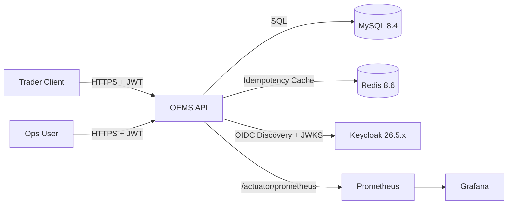

# OEMS Phase 1 - System Context

Last updated: 2026-03-15

## Overview

This diagram shows the Phase 1 runtime context with external actors and core dependencies.

## Notes

1. MySQL is the primary source of truth for orders, events, and idempotency records.
2. Redis is a performance optimization for idempotency lookup, not the source of truth.
3. Keycloak issues and validates JWT tokens consumed by the API.
