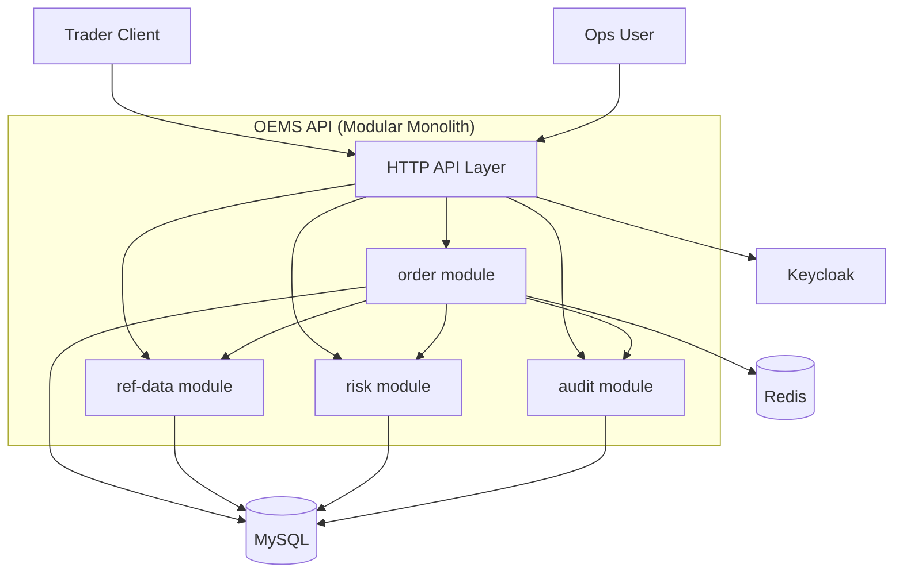

# OEMS Phase 1 - Container View

Last updated: 2026-03-15

## Overview

Phase 1 is implemented as a modular monolith. This view shows runtime modules and their primary dependencies.

## Module Responsibilities

1. `ref-data`: instrument lookup and tradability constraints.
2. `order`: request orchestration, idempotency, and persistence of order state.
3. `risk`: pre-trade checks (max quantity, max notional, price band).
4. `audit`: immutable order-event trail creation and retrieval.
