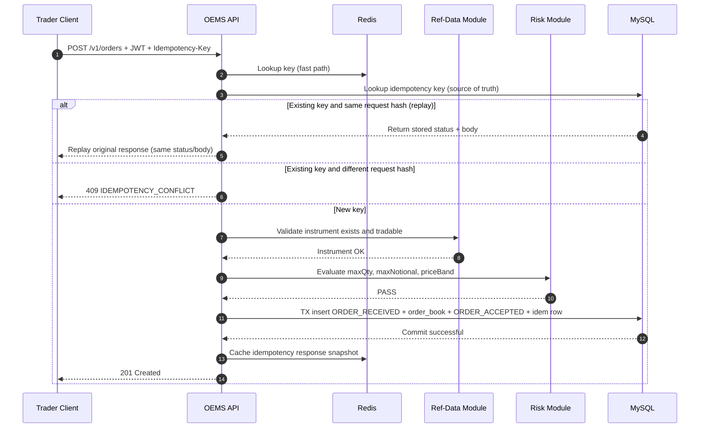

# OEMS Phase 1 - Sequence: Place Order

Last updated: 2026-03-15

## Overview

This sequence covers the successful order path and idempotent replay behavior.

## Notes

1. DB check remains authoritative even when Redis is used.
2. Success and replay paths return deterministic results for the same idempotency key and payload hash.
