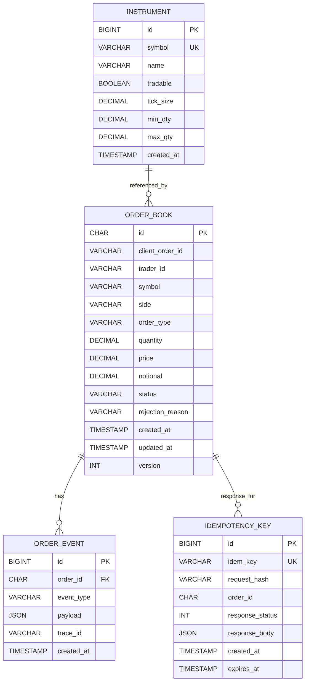

# OEMS Phase 1 - ERD

Last updated: 2026-03-15

## Core Tables

The following ERD models the Phase 1 core entities required for order placement, audit, and idempotency.

## Notes

1. `ORDER_EVENT` is append-only and provides immutable audit traceability.
2. `IDEMPOTENCY_KEY` stores canonical response snapshots for deterministic replays.
