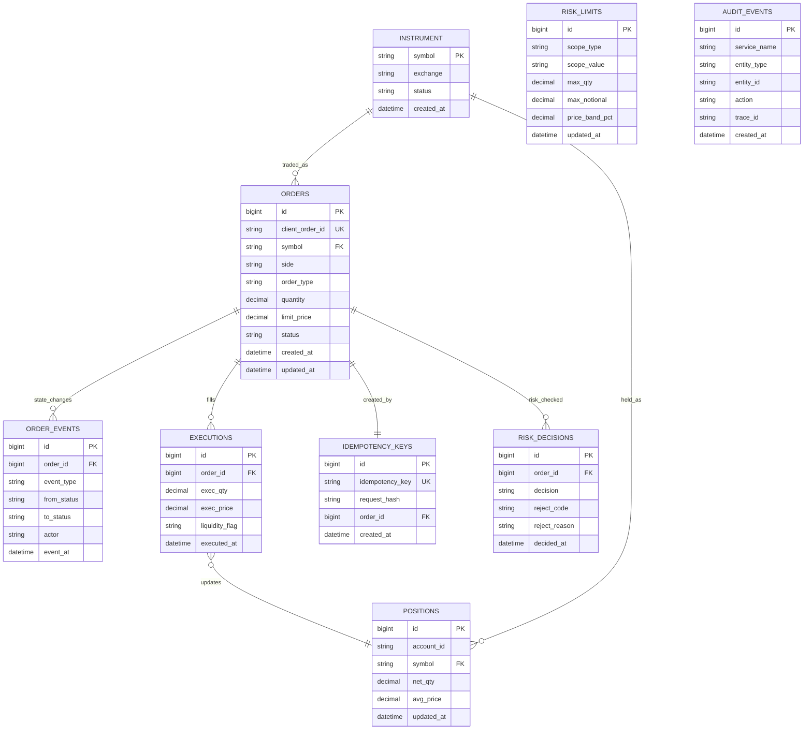

# OEMS Database ER Diagram (Conceptual)

## Service Ownership (Logical)

- `reference-data-service`: `INSTRUMENT`
- `order-service`: `ORDERS`, `ORDER_EVENTS`, `IDEMPOTENCY_KEYS`
- `risk-service`: `RISK_LIMITS`, `RISK_DECISIONS`
- `execution-sim-service`: `EXECUTIONS` (or local simulation tables if separated)
- `portfolio-service`: `POSITIONS`
- `audit-reporting-service`: `AUDIT_EVENTS`
